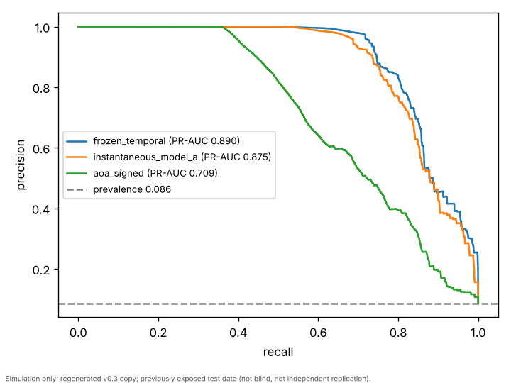
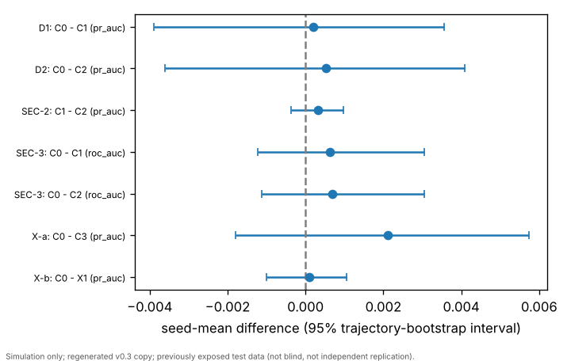
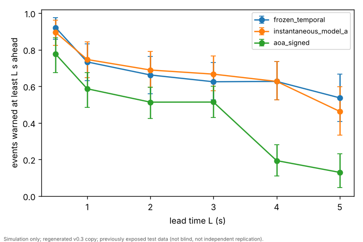
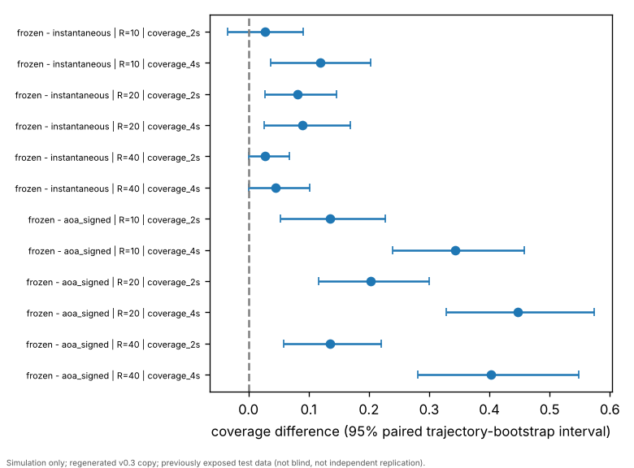
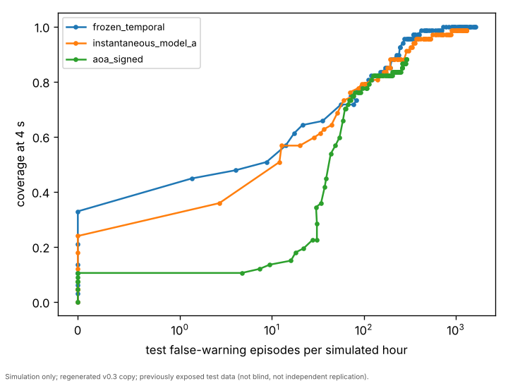

# AeroGuard comparison report — Items 33–40 (run `run_20261015T144358282823Z`)

> Simulation only; regenerated v0.3 copy; previously exposed test data (not blind, not independent replication). Rates are per simulated hour of eligible evaluation time. No acceptable false-alarm rate, required coverage or meaningful-effect margin is defined. Nothing here is evidence about real aircraft, and no causal claim is made.

Generated from machine-readable results only (protocol SHA-256 `9076e0aca72ff90e830a8932e8bca3128c6c882bb0b330e629cb7a2cdeef7242`). Every headline statement is re-derived independently by the Item 42 checks (`item42_checks.json`).

## 1. Threshold-free comparison (Phase 3, paired trajectory bootstrap, B = 1000)

| Method | PR-AUC [95% CI] | ROC-AUC [95% CI] |
|---|---|---|
| aoa_signed | 0.7095 [0.667, 0.7448] | 0.905 [0.8762, 0.931] |
| aoa_two_sided | 0.7089 [0.6664, 0.7445] | 0.9013 [0.8709, 0.9297] |
| instantaneous_model_a | 0.8754 [0.8345, 0.9114] | 0.9714 [0.9589, 0.9822] |
| frozen_temporal | 0.8903 [0.8535, 0.9224] | 0.9775 [0.969, 0.9857] |

Prevalence (positive-row fraction): 0.0858. Paired differences:

- Phase 3 frozen_temporal - instantaneous_model_a | pr_auc: 0.01484 [0.007927, 0.02302]; interval excludes 0.
- Phase 3 frozen_temporal - aoa_signed | pr_auc: 0.1808 [0.1505, 0.2192]; interval excludes 0.
- Phase 3 instantaneous_model_a - aoa_signed | pr_auc: 0.166 [0.1341, 0.2047]; interval excludes 0.

*Figure (a): test precision-recall curves.* Simulation only; regenerated v0.3 copy; previously exposed test data (not blind, not independent replication).

## 2. Control-input ablation (Item 33, retrained models, seed mean over 5 seeds)

- Item 33 D1 (primary) PR-AUC C0 - C1: 0.0001929 [-0.0039, 0.003554]; interval includes 0.
- Item 33 D2 (primary) PR-AUC C0 - C2: 0.0005192 [-0.003604, 0.004087]; interval includes 0.
- Item 33 SEC-2 (secondary) PR-AUC C1 - C2: 0.0003263 [-0.0003743, 0.0009729]; interval includes 0.
- Item 33 X-a (exploratory) PR-AUC C0 - C3: 0.002116 [-0.001803, 0.00573]; interval includes 0.
- Item 33 X-b (exploratory) PR-AUC C0 - X1: 0.0001021 [-0.001005, 0.001048]; interval includes 0.

No difference was demonstrated for any PR-AUC contrast. This does not show that the conditions perform alike (no margin was defined). Frozen-model input masking (a different analysis) changed PR-AUC by -0.105 to -0.010.

*Figure (d): Item 33 control-input ablation contrasts. All intervals include 0: no difference demonstrated; not evidence of no effect.* Simulation only; regenerated v0.3 copy; previously exposed test data (not blind, not independent replication).

## 3. Data counts, false warnings and coverage at each method's own threshold (Items 37–39)

Test: 538,034 usable rows, 456 trajectories, 1.493 eligible simulated hours, 76 stall events in 57 trajectories. Thresholds are not matched across methods here, so these rows are not ranked.

| Method | False episodes / sim. hour [95% CI] | Coverage 2 s | Coverage 4 s |
|---|---|---|---|
| aoa_signed | 23.44 [14.87, 33.38] | 0.5135 [0.4246, 0.595] | 0.194 [0.1094, 0.2806] |
| aoa_two_sided | 23.44 [14.87, 33.38] | 0.5135 [0.4246, 0.595] | 0.194 [0.1094, 0.2806] |
| instantaneous_model_a | 29.47 [17.64, 43.78] | 0.6892 [0.5937, 0.7904] | 0.6269 [0.527, 0.7361] |
| frozen_temporal | 18.75 [11.57, 26.84] | 0.6622 [0.56, 0.7627] | 0.6269 [0.527, 0.7361] |

*Figure (b): coverage against lead time at each method's own validation-selected threshold (Items 37-39), 95% trajectory-bootstrap intervals.* Simulation only; regenerated v0.3 copy; previously exposed test data (not blind, not independent replication).

## 4. Fair comparison at validation-matched false-warning rates (Item 40)

Thresholds were chosen on validation data only so that each method's validation false-episode rate is at most R per simulated hour. R is a comparison grid, not an acceptable rate. Test rates are not equal across methods and are shown next to coverage.

| Method | R | Threshold | Val. rate | Test false / sim. hour [95% CI] | Test coverage 2 s | Test coverage 4 s | Sustained 4 s |
|---|---|---|---|---|---|---|---|
| frozen_temporal | 10 | 0.973167 | 8.801 | 5.357 [0.6589, 12.17] | 0.527 [0.4285, 0.6203] | 0.4776 [0.3846, 0.5714] | 0.1045 [0.03947, 0.1803] |
| frozen_temporal | 20 | 0.890136 | 19.07 | 10.05 [4.651, 16.52] | 0.6486 [0.5536, 0.75] | 0.597 [0.5, 0.7015] | 0.3582 [0.254, 0.4792] |
| frozen_temporal | 40 | 0.862007 | 39.6 | 20.09 [12.63, 29.03] | 0.6622 [0.56, 0.7627] | 0.6269 [0.527, 0.7361] | 0.4179 [0.3043, 0.5469] |
| instantaneous_model_a | 10 | 0.961019 | 9.534 | 2.679 [0, 6.75] | 0.5 [0.4109, 0.5851] | 0.3582 [0.2658, 0.459] | 0 [0, 0] |
| instantaneous_model_a | 20 | 0.951701 | 19.07 | 10.71 [0, 25.8] | 0.5676 [0.4746, 0.6548] | 0.5075 [0.4117, 0.6001] | 0.04478 [0, 0.09836] |
| instantaneous_model_a | 40 | 0.896765 | 39.6 | 24.11 [10.01, 42.12] | 0.6351 [0.5455, 0.7308] | 0.5821 [0.4925, 0.6858] | 0.3731 [0.2656, 0.493] |
| aoa_signed | 10 | 0.24471 | 9.534 | 7.366 [3.346, 11.59] | 0.3919 [0.3125, 0.4627] | 0.1343 [0.05968, 0.2157] | 0 [0, 0] |
| aoa_signed | 20 | 0.229974 | 19.8 | 13.39 [7.329, 19.61] | 0.4459 [0.359, 0.5239] | 0.1493 [0.07266, 0.2334] | 0 [0, 0] |
| aoa_signed | 40 | 0.208826 | 38.87 | 30.14 [20.12, 41] | 0.527 [0.4375, 0.6057] | 0.2239 [0.1356, 0.3108] | 0.07463 [0.01639, 0.1407] |

Paired contrasts (18 in total, unadjusted, descriptive; "interval excludes 0" is not a p-value):

- Item 40 frozen_temporal - instantaneous_model_a | R=10 | coverage_2s: 0.02703 [-0.03391, 0.09093]; interval includes 0.
- Item 40 frozen_temporal - instantaneous_model_a | R=10 | coverage_4s: 0.1194 [0.03702, 0.2035]; interval excludes 0.
- Item 40 frozen_temporal - instantaneous_model_a | R=10 | false_per_sim_hour: 2.679 [-1.381, 7.911]; interval includes 0.
- Item 40 frozen_temporal - instantaneous_model_a | R=20 | coverage_2s: 0.08108 [0.02739, 0.1467]; interval excludes 0.
- Item 40 frozen_temporal - instantaneous_model_a | R=20 | coverage_4s: 0.08955 [0.02665, 0.1688]; interval excludes 0.
- Item 40 frozen_temporal - instantaneous_model_a | R=20 | false_per_sim_hour: -0.6697 [-14.69, 10.91]; interval includes 0.
- Item 40 frozen_temporal - instantaneous_model_a | R=40 | coverage_2s: 0.02703 [0, 0.06781]; interval includes 0.
- Item 40 frozen_temporal - instantaneous_model_a | R=40 | coverage_4s: 0.04478 [0, 0.1017]; interval includes 0.
- Item 40 frozen_temporal - instantaneous_model_a | R=40 | false_per_sim_hour: -4.018 [-20.54, 9.349]; interval includes 0.
- Item 40 frozen_temporal - aoa_signed | R=10 | coverage_2s: 0.1351 [0.05355, 0.2267]; interval excludes 0.
- Item 40 frozen_temporal - aoa_signed | R=10 | coverage_4s: 0.3433 [0.2394, 0.4576]; interval excludes 0.
- Item 40 frozen_temporal - aoa_signed | R=10 | false_per_sim_hour: -2.009 [-7.999, 4.751]; interval includes 0.
- Item 40 frozen_temporal - aoa_signed | R=20 | coverage_2s: 0.2027 [0.1165, 0.3]; interval excludes 0.
- Item 40 frozen_temporal - aoa_signed | R=20 | coverage_4s: 0.4478 [0.3284, 0.5738]; interval excludes 0.
- Item 40 frozen_temporal - aoa_signed | R=20 | false_per_sim_hour: -3.348 [-11.67, 5.546]; interval includes 0.
- Item 40 frozen_temporal - aoa_signed | R=40 | coverage_2s: 0.1351 [0.05881, 0.2208]; interval excludes 0.
- Item 40 frozen_temporal - aoa_signed | R=40 | coverage_4s: 0.403 [0.2816, 0.5484]; interval excludes 0.
- Item 40 frozen_temporal - aoa_signed | R=40 | false_per_sim_hour: -10.05 [-22.55, 1.994]; interval includes 0.

*Figure (e): Item 40 coverage contrasts at validation-matched false-warning rates (descriptive, unadjusted; 18 contrasts in total).* Simulation only; regenerated v0.3 copy; previously exposed test data (not blind, not independent replication).

*Figure (c): test false-episode rate against coverage at 4 s over the validation threshold grid (every 10th level). Descriptive, drawn from test data, not used for any choice.* Simulation only; regenerated v0.3 copy; previously exposed test data (not blind, not independent replication).

## 5. Checks (Item 42)

| Check | Status |
|---|---|
| L1 | PASS |
| L2 | PASS |
| L3 | PASS |
| L4 | PASS |
| L5 | PASS |
| M1 | PASS |
| M2 | PASS |
| M3 | PASS |
| M4 | PASS |
| M5 | PASS |

C1 (headline statements re-derived) and C2 (wording scan) are recorded in `item42_checks.json` after this report is written.

## 6. Limitations

- Previously exposed test data on a regenerated copy; about 1.49 simulated hours and 76 events in 57 trajectories; intervals are wide.
- The trajectory bootstrap treats trajectories as exchangeable; shared simulator regimes may make it understate uncertainty.
- One simulated aircraft with scripted, open-loop controls. Nothing here transfers to real aircraft without new evidence.

## Sources

- `outputs/phase3/run_20261013T140820817642Z/bootstrap.json` — SHA-256 `54d5de8384e26500a8a17e0df0d82eecea4e2d76f8d53fe7016630b8275b0c5a`
- `outputs/phase3/run_20261013T140820817642Z/metrics_primary.json` — SHA-256 `2fba0c6e0eb03709fcbbb65761064e9ed3773710f74604c0bc73e1f142d8a3de`
- `outputs/items33_42/item33/run_20261013T162344038252Z/paired_contrasts.json` — SHA-256 `90bd998951154250d5b21904b88bbc6fa704919eccb23d1c1860d9a7c49e34d7`
- `outputs/items33_42/item33/run_20261013T162344038252Z/masking_results.json` — SHA-256 `95b385e017d93539441420d0e885f90fad3e93bba5c1c5511be73c7ceb9c3a6d`
- `outputs/items33_42/items37_39/run_20261015T143215846532Z/counts_item39.json` — SHA-256 `900e1d987cbb4406456943ddfa1cfad39529bdc0ded79a3ea6cf5692df731661`
- `outputs/items33_42/items37_39/run_20261015T143215846532Z/false_alarms_item37.json` — SHA-256 `a4f9eb3225cd977a682cabbab583e5c1e2657912153e6d99bf081f95ffda67d8`
- `outputs/items33_42/items37_39/run_20261015T143215846532Z/coverage_item38.json` — SHA-256 `00c4b394df4ae5522f48265005a10796821b18a1887989d687a426f15b8c8df3`
- `outputs/items33_42/items40_42/run_20261015T144358282823Z/item40_matched_operating_points.json` — SHA-256 `c051e202f8f368a639ea5f6a697ce7985ef46bcf7de4a31a010a03af991c9cd7`
